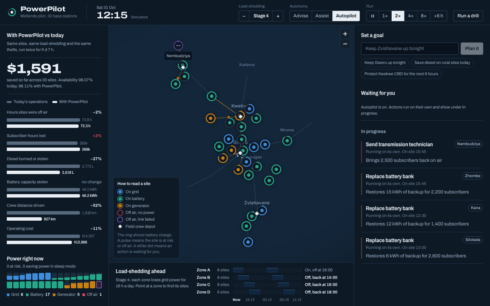

# PowerPilot

PowerPilot keeps mobile base stations on air through load-shedding. It predicts which sites will run out of power,
spots battery and diesel theft while it is happening, and tells field teams exactly where to go first.

This repository is a working prototype built for a pilot with NetOne on 30 base stations in the Midlands.
Everything you see runs on a simulated network, so it can be demonstrated today without access to live systems.



## What it does

- **Predicts outages before they happen.** Every 15 minutes each site is projected forward 24 hours against the
  published ZESA schedule, its battery, its diesel and its expected traffic. A gradient-boosted model scores the
  risk of the site going dark in the next six hours.
- **Saves diesel without a site visit.** Capacity layers sleep when traffic is low. Generators only start when the
  battery cannot reach the next grid window, then charge the battery hard so they run fewer, more efficient hours.
- **Catches theft in progress.** Fuel and battery readings are checked against normal sensor noise. A sudden drop with
  the door open at night raises a security dispatch within one reading.
- **Puts an engineer in control.** Each action shows how it was reached (monitor, diagnose, plan, dispatch) and waits
  for one tap. Autonomy can be set to advise, assist or autopilot.
- **Takes plain-language goals.** “Keep Gweru up tonight” or “Save diesel on rural sites today” becomes a plan for
  the right sites over the right window.

## Results on the simulated Midlands network

Both versions of the network face the same load-shedding, weather, faults and thefts. Only the way they are operated
differs. Seven days at Stage 4 (16 hours without grid per zone per day):

| | Today’s operations | With PowerPilot | Change |
|---|---:|---:|---:|
| Hours sites were off air | 88.0 | 10.8 | −88% |
| Network availability | 98.25% | 99.79% | |
| Diesel burned | 2,806 L | 2,112 L | −25% |
| Diesel stolen | 660 L | 270 L | −59% |
| Generator run hours | 1,459 | 860 | −41% |
| Crew distance | 2,997 km | 2,310 km | −23% |
| Operating cost, including lost revenue | $16,407 | $9,626 | −41% |

Reproduce it, or try other seeds and stages:

```bash
cd backend
python -m powerpilot.benchmark --days 7 --stage 4
python -m powerpilot.benchmark --days 7 --stage 2 --seed 42
```

These numbers come from a simulation. Prices, theft rates and battery health are assumptions set in
[`backend/powerpilot/config.py`](backend/powerpilot/config.py) and
[`backend/powerpilot/environment.py`](backend/powerpilot/environment.py). Measuring the real figures on NetOne
telemetry is the purpose of the pilot.

## Run it

You need Python 3.11+ and Node 20+.

```bash
# Terminal 1: simulation, models and API on http://localhost:8000
cd backend
pip install -r requirements.txt
uvicorn powerpilot.api:app --port 8000

# Terminal 2: console on http://localhost:5173
cd frontend
npm install
npm run dev
```

The network clock starts running on its own. Use **Run a drill** to stage a battery theft, diesel siphoning, a link
failure or a ZESA fault, then approve the response that appears under **Waiting for you**.

| Setting | Where | Default |
|---|---|---|
| Autonomy level | `POWERPILOT_AUTONOMY` | `assist` |
| Seconds per 15-minute step at 1× | `POWERPILOT_TICK_SECONDS` | `1.0` |
| Start with the clock paused | `POWERPILOT_AUTOPLAY=0` | running |
| API address for the console | `frontend/.env`, `VITE_API_URL` | same origin |
| Map style | `frontend/.env`, `VITE_BASEMAP_STYLE` | OpenFreeMap dark |

Without internet access the map falls back to a built-in outline of Zimbabwe with the main Midlands roads.

## How it fits together

```
backend/powerpilot
  sites.py         30 Midlands sites, their power systems and the field depots
  environment.py   load-shedding schedule, traffic, solar, faults and thefts shared by both networks
  power.py         energy balance of one site for one 15-minute step
  network.py       a running network with crews, jobs and today’s reactive NOC process
  models.py        demand forecast, outage-risk model, theft detection and 24-hour site projection
  engine.py        runs both networks, scores every site and raises recommendations
  goals.py         turns plain-language goals into a scope and a time window
  api.py           HTTP API used by the console
  benchmark.py     side-by-side run from the command line

frontend/src
  components/NetworkMap.vue      live map of every site, crew routes and depots
  components/ApprovalQueue.vue   actions waiting for an engineer, with their reasoning
  components/SiteDetail.vue      one site: readings, 36-hour battery chart, equipment
  components/LedgerPanel.vue     the same network with and without PowerPilot
  components/SheddingLoom.vue    the next 24 hours of load-shedding for each zone
```

## Tests

```bash
cd backend
pip install -r requirements-dev.txt
ruff check .
pytest
```

## Pilot proposal

See [docs/pilot-plan.md](docs/pilot-plan.md) for the 90-day pilot: scope, data needed, timeline and how success is
measured.

---

© 2026 Ubuntu Software Labs. All rights reserved.
